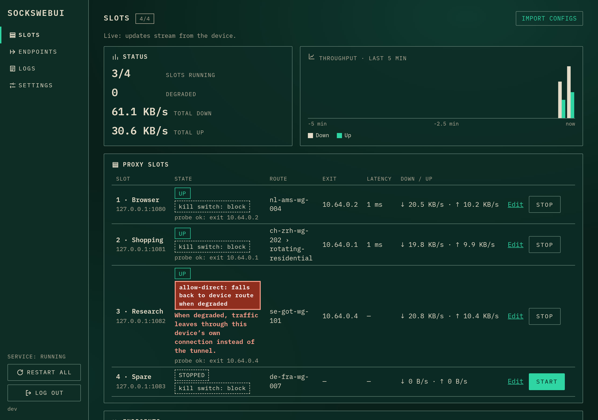
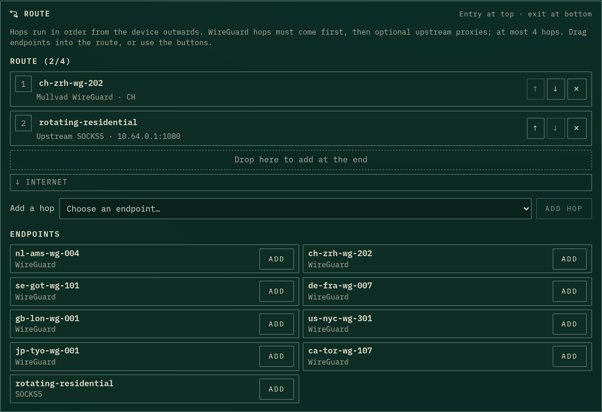
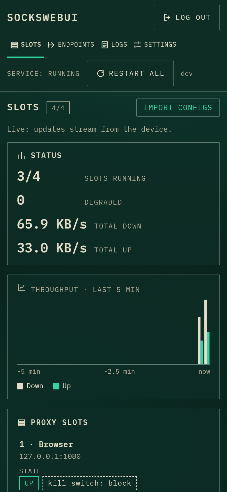
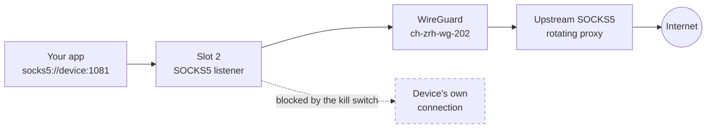

# sockswebui

Run up to four SOCKS5 proxies on a Raspberry Pi, thin client or router, and send each one out through
its own chain of WireGuard tunnels and upstream proxies. You set everything up in a web UI.

[](https://github.com/M-Wham/sockswebui/releases/latest)
[](LICENSE)




sockswebui is one static Go binary with the UI built in. WireGuard runs in user space, so it needs no root
access, kernel module or TUN device. Point any app or browser at `socks5://<device>:<port>`, and its
traffic leaves through the route you picked for that slot. If the route breaks, the slot stops sending
traffic instead of falling back to your own connection.

## Contents

- [Features](#features)
- [How it works](#how-it-works)
- [Install](#install)
- [Quick start](#quick-start)
- [Security model](#security-model)
- [Platforms and requirements](#platforms-and-requirements)
- [Limits](#limits)
- [Build from source](#build-from-source)
- [Licence](#licence)

## Features

- **Four independent slots:** each slot is its own SOCKS5 proxy with its own port, route, kill switch
  and optional username and password. You start and stop each slot on its own.
- **Routes you build:** chain WireGuard tunnels from any provider, then add optional upstream SOCKS5 or HTTP
  proxies, up to four hops in all. Drag endpoints into the route, or use the buttons.
- **Kill switch, fail-closed by default:** when a hop dies, the slot blocks traffic at once. Only a slot set to
  `allow-direct` may fall back to the device's own connection, and the Slots table flags such slots in red.
- **Drag-and-drop WireGuard import:** drop `.conf` files or a whole `.zip`. Each file reports its own result.
  Mullvad file names are labelled with relay and country automatically.
- **Live Slots screen:** state, exit IP, latency and throughput update as they change. A chart shows
  throughput for the last 5 minutes. Health checks probe through the full route. **Restart all** restarts
  every enabled slot.
- **New IP button:** for rotating proxies that pick the exit from a session ID in the credentials, one press
  gives the slot a new session and a new exit. This works with any provider that uses this scheme.
- **Move to another device:** export the configuration as an encrypted file and import it on a second device.
- **Logs per slot:** secrets are redacted.
- **Works on a phone:** the UI fits a 360 px screen.

<p align="center">
  
  &nbsp;
  
</p>

## How it works

Each slot listens for SOCKS5 clients. For every connection, it dials through the slot's route, one hop
after another. WireGuard hops come first, then any upstream proxies. Nothing else in the program opens
outbound connections.



A health check probes each running slot through its full route. When the probes fail, the slot moves to
`DEGRADED`. A slot set to `block` (the default) refuses new connections until the route recovers. A slot
set to `allow-direct` sends traffic through the device's own connection while it is degraded.

## Install

sockswebui is meant for a device on a trusted home or office network. See
[Security model](#security-model) before you install it.

**Install script** (Debian, Raspberry Pi OS, other systemd distros, OpenWrt). Run as root:

```sh
curl -fsSL https://github.com/M-Wham/sockswebui/releases/latest/download/install.sh | sudo sh
```

The script picks the right build for your device and checks every download against the release's
`SHA256SUMS` before it installs anything. On Debian and Raspberry Pi OS it installs the `.deb`. Elsewhere it
installs the binary with a systemd unit or an OpenWrt init script. To read the script before you run it:

```sh
curl -fsSLO https://github.com/M-Wham/sockswebui/releases/latest/download/install.sh
curl -fsSLO https://github.com/M-Wham/sockswebui/releases/latest/download/SHA256SUMS
sha256sum -c --ignore-missing SHA256SUMS
sudo sh install.sh
```

Run `sudo sh install.sh` again to upgrade, or `sudo sh install.sh --uninstall` to remove it. Uninstall keeps
your data directory.

**Debian package.** Download `sockswebui_<version>_<arch>.deb` (`amd64`, `arm64` or `armhf`) from the
[latest release](https://github.com/M-Wham/sockswebui/releases/latest), then:

```sh
sudo apt install ./sockswebui_*_arm64.deb
```

**Docker** (amd64, arm64, arm/v7):

```sh
docker run -d --name sockswebui --restart unless-stopped --network host \
  -v sockswebui-data:/data ghcr.io/m-wham/sockswebui:latest
```

Host networking is needed because you choose the slot ports in the UI after the container starts.

**By hand.** Download the binary for your device and `SHA256SUMS` from the
[latest release](https://github.com/M-Wham/sockswebui/releases/latest), check it with
`sha256sum -c --ignore-missing SHA256SUMS`, and follow the systemd or OpenWrt steps in
[docs/INSTALL.md](docs/INSTALL.md).

[docs/INSTALL.md](docs/INSTALL.md) covers every method in detail, plus changing the UI address, HTTPS behind
a reverse proxy, backups and resetting the admin password.

## Quick start

1. Open `http://<device-ip>:8787/` and **set the admin password at once**. Until you do, anyone who can
   reach the UI can set it.
2. Go to **Endpoints**. Drop your WireGuard `.conf` files or a `.zip` onto the import box. To use an
   upstream SOCKS5 or HTTP proxy, add it with **Add proxy**.
3. On **Slots**, press **Edit** on a slot. Choose the bind address (`0.0.0.0` for the whole network)
   and a port, build the route, and keep the kill switch on **Block**.
4. Press **Start**. When the slot shows `UP` and an exit IP, point your app at `socks5://<device-ip>:<port>`.

To try it without installing a service:

```sh
./sockswebui --data-dir ./data --ui-addr 127.0.0.1:8787
```

| Flag | Purpose |
|---|---|
| `--data-dir <dir>` | Where `config.json` (settings and secrets) lives. |
| `--ui-addr <addr:port>` | Overrides the UI address saved in Settings (default `0.0.0.0:8787`). |
| `--ui-host <name>` | Extra host name the UI accepts, e.g. the name behind a reverse proxy. Repeatable. |
| `--reset-admin` | With the service stopped: clears the admin password, so the next start shows setup. |
| `--version` | Prints the version. |

## Security model

- **Fail closed:** no connection reaches the internet through the device's own route unless that slot is set
  to `allow-direct`.
- **Secrets are write-only:** WireGuard keys, proxy passwords and SOCKS passwords never appear in an API
  response or a log. The UI shows only whether a secret is set.
- **One admin:** the password is stored as an argon2id hash. Logins are rate-limited. The UI checks the
  `Host` and `Origin` headers and uses CSRF tokens.
- **Trusted LAN only:** the UI serves plain HTTP. Do not expose it, or any slot, to the internet. For HTTPS,
  put it behind a [reverse proxy](docs/INSTALL.md#reverse-proxy).
- **Finish setup at once:** before the admin password is set, the setup page is open to anyone who can reach
  it. The same applies after `--reset-admin` or after restoring a backup.
- **Protect the data directory:** `config.json` holds your WireGuard keys and proxy passwords. Exports can be
  encrypted with a passphrase.

## Platforms and requirements

| Platform | Builds | Status |
|---|---|---|
| linux/amd64 | binary, `.deb`, Docker | Binary tested in a Debian 13 LXC container (1 core, 512 MB RAM), 2026-10-13, build 9ea8cd8. The `.deb`, Docker image and `install.sh` were tested in containers only |
| linux/arm64 | binary, `.deb`, Docker | Built, needs more testing |
| linux/arm/v7 | binary, `.deb` (`armhf`), Docker | Built, needs more testing |
| linux/mipsle, linux/mips | binary (OpenWrt) | Built, needs more testing |

The device needs at least 512 MB of RAM. The 32-bit ARM build needs ARMv7 with hardware floating point,
so it does not run on a Raspberry Pi Zero or Pi 1. Reports from other devices are welcome.

## Limits

- TCP only: no SOCKS5 UDP ASSOCIATE, no SOCKS4 and no transparent proxying.
- WireGuard only for tunnels: no OpenVPN.
- A WireGuard hop cannot come after a proxy hop, because proxies carry TCP and WireGuard needs UDP.
- One admin account. There are no multiple users or roles.
- Exit-IP rotation is manual (the **New IP** button), never timed, because many providers bill per IP.

## Build from source

You need Go and Node.js with npm.

```sh
make build      # bin/sockswebui for this machine
make release    # static binaries for all five targets, .deb packages and SHA256SUMS in dist/
```

All builds use `CGO_ENABLED=0`, so the binaries have no runtime dependencies.

## Licence

[MIT](LICENSE).
